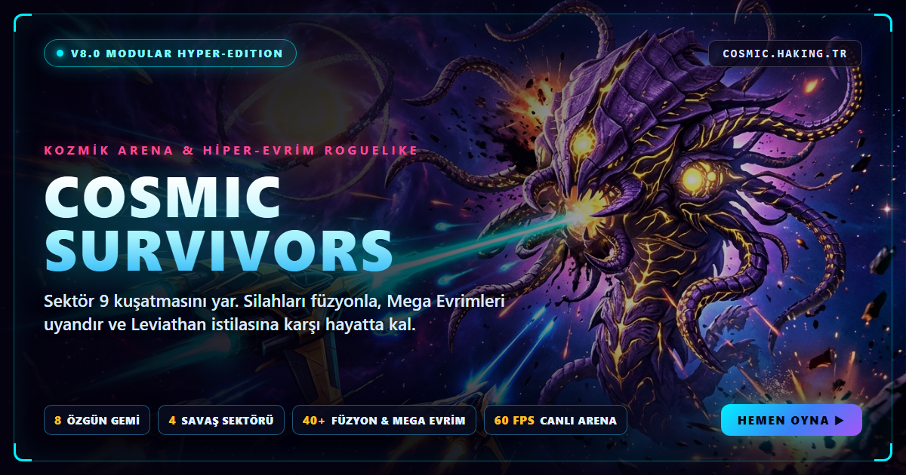

<div align="center">



<br />

# 🌌 COSMIC SURVIVORS
### **KOZMİK ARENA & HİPER-EVRİM ROGUELIKE (v8.0 — MODULAR HYPER-EDITION)**

[](https://cosmic.haking.tr/)
[](https://cosmic.haking.tr/tree.html)
[](https://cosmic.haking.tr/wiki.html)
[](https://cosmic.haking.tr/about.html)
[](https://buymeacoffee.com/haking)
[](LICENSE)

<p align="center">
  <strong>Modüler Web Mimarisi (Harici CSS/JS/Asset Paketi) • 8 Özgün Yıldız Gemisi & 3D/HD Modeller • 4 Dinamik Sektör Haritası • Kalıcı Reaktör Atölyesi (💎 Kozmik Kredi) • Profesyonel Filtrelenebilir Katalog & Gemi Kıyaslama • 15 Çapraz Evrim ($X+Y=Z$) & 8 Mega Evrim ($Z+N=\text{MEGA}$)</strong>
</p>

---

### 🚀 **[⚡ CANLI SİMÜLASYONU BAŞLAT — https://cosmic.haking.tr/](https://cosmic.haking.tr/)**
### 📚 **[🧠 KOZMİK WİKİ & VERİTABANI — https://cosmic.haking.tr/wiki.html](https://cosmic.haking.tr/wiki.html)**
### ☕ **[💛 PROJEYİ DESTEKLE — https://buymeacoffee.com/haking](https://buymeacoffee.com/haking)**
### 📩 **Resmi İletişim: [cosmic@haking.tr](mailto:cosmic@haking.tr)**

</div>

---

## 📖 Genel Bakış

**COSMIC SURVIVORS — Kozmik Arena & Hiper-Evrim Roguelike (v8.0)**, harici `css/`, `js/` ve yüksek detaylı `assets/` (`ships/`, `bosses/`, `enemies/`, `maps/`) paket yapısıyla sıfırdan inşa edilmiş, çok sayfalı ve tam donanımlı bir web oyun portalıdır.

- **🛸 8 Özgün Yıldız Gemisi & 3D/2.5D Canlı Vitrin (`models3d.js`):** Her biri çok katmanlı SVG/PNG yüksek çözünürlüklü gövde modellerine, 2.5D yatış (banking) fiziğine, döner taretlere, kendine özel **İmza Kök Silahı + Kök Aletine** ve **Aktif Yeteneğe (`SPACE`)** sahip 8 gemi sınıfı.
- **📋 Profesyonel Filtrelenebilir Katalog & Yan Yana Gemi Kıyaslama:** Hangar içinde ve Wiki sayfasında arama, kategori/gemi filtreleme, hasar/tier sıralama, Tablo/Kart görünüm değiştirici ve iki gemiyi yan yana kıyaslayan **Gemi Karşılaştırma Laboratuvarı**.
- **🔧 Kalıcı Reaktör Atölyesi (Meta-Progression & 💎 Kozmik Kredi):** Savaşlarda ve başarımlarda kazanılan **Kozmik Krediler** ile tüm gemilerin hasar, gövde, hız, kritik, dolum süresi ve Reroll/Skip haklarını kalıcı olarak yükseltme imkanı.
- **🗺️ 4 Dinamik Sektör Haritası & Taktiksel Radar Mini-Harita:** *Sektör 9 Enkazı*, *Kuantum Nebulası*, *Kara Delik Çevresi* ve yeni *Dyson Mega-Küre Reaktörü* ile oyun içi canlı **Radar Mini-Harita**.

---

## 🛸 8 Özgün Yıldız Gemisi & İmza Kök Ağaçları

| Gemi Sınıfı | Rol & Kademe | Başlangıç Silahı | Özel Kök Silahı + Aleti | Özel Evrim ➔ Mega Evrim | Aktif Yetenek (`SPACE`) |
| :--- | :--- | :--- | :--- | :--- | :--- |
| **⚡ Avcı (`Interceptor`)** | Hızlı Taarruz (`S`) | Çift Lazer | Foton Raylı Top + Hiper-İvme | Takyon Mızrağı ➔ **Hyperion Işık Hükümdarı** | **Warp Dash** |
| **🛡️ Kruvazör (`Dreadnought`)** | Ağır Kuşatma (`S`) | Ağır Plazma Topu | Balistik Flak + Reaktif Zırh | Kıyamet Bataryası ➔ **Zırhlı Kıyamet Kalesi** | **360° Füze Salvosu** |
| **💠 Aegis (`Guardian`)** | Yörünge & EMP (`A+`) | Dönen Enerji Diski | Tesla Prizması + Kondansatör | Kutsal İyon Fırtınası ➔ **Olay Ufku** | **EMP Şok Dalgası** |
| **👻 Gölge (`Void Phantom`)** | Kuantum Suikast (`S`) | Kuantum Hançeri | Hiper-Uzay Tırpanı + Gölge Pelerini | Hiçlik Biçicisi ➔ **Tutulma Tanrısı** | **Gölge Sıçraması** |
| **☀️ Solar Flare (`Sunstorm`)** | Termal AoE (`S`) | Alev Hattı | Plazma Havanı + Termonükleer Kalp | Helios Kıyameti ➔ **Omega Hükmü** | **Güneş Patlaması** |
| **❄️ Tempest (`Cryo-Storm`)** | Kriyo-Kontrol (`S`) | Çift Lazer / Ark | Kriyo-Buzul Küresi + İletken Bobin | **Mutlak Sıfır Fırtınası** | **Kriyo-Tesla Fırtınası** |
| **🛸 Valkyrie (`Carrier`)** | Drone Taşıyıcı (`S+`) | Füze Sürüsü | Otonom Dronelar + Nöral Ağ | **Seraphim Drone Filosu** | **Railgun Overdrive** |
| **⏳ Chronos (`Singularity`)** | Zaman Bükücü (`S+`) | Enerji Diski | Zaman Yarığı + Akı Çekirdeği | **Sonsuzluk Döngüsü** | **Zaman Durdurma (Stasis)** |

---

## 🗂️ Modüler Proje Mimarisi

```text
COSMIC/
├── index.html                  # [KOMUTA HANGARI] 5 Modüllü Portal (3D Vitrin, Profesyonel Katalog, Atölye, Sektörler, Başarımlar)
├── game.html                   # [SAVAŞ ARENASI] Radar Mini-Harita, Minimalist HUD, ESC Terminali, Evrim & Sandık Modalları
├── tree.html                   # [EVRİM LABORATUVARI] 8 Gemi Sekmeli İnteraktif SVG Perk Ağacı & Sentez Hesaplayıcı
├── wiki.html                   # [KOZMİK WİKİ] Canlı Arama/Sıralama Veritabanı, 4x8 Harita Sinerji Matrisi, Hasar Hesaplayıcı
├── about.html                  # [SEKTÖR 9 ARŞİVİ] Lore, Kurumsal İletişim, Destek Kartı & MIT Lisansı
├── css/
│   ├── core.css                # Global Tasarım Sistemi, Tablo/Filtre/Kart Bileşenleri, %75 Responsive Ölçek
│   ├── lobby.css               # Hangar Portalı, 3D Turntable, Katalog & Reaktör Atölyesi Stilleri
│   ├── game.css                # Savaş Arenası HUD, Radar Mini-Harita & Hologram Kart Stilleri
│   ├── tree.css                # İnteraktif Yetenek Ağacı & Sentez Simülatörü Stilleri
│   └── wiki.css                # Wiki Veritabanı, Sekmeler & Kurumsal Arşiv Stilleri
├── js/
│   ├── data.js                 # Merkezi Veritabanı (8 Gemi, 4 Harita, Katalog, Atölye) & CosmicPersistence
│   ├── models3d.js             # 2.5D/3D Gemi, Boss, Düşman & Hangar Turntable Model Çizim Motoru
│   ├── lobby.js                # Hangar, Profesyonel Katalog, Gemi Kıyaslama & Atölye Kontrolcüsü
│   ├── tree.js                 # İnteraktif Evrim Ağacı & Sentez Simülatörü Motoru
│   └── wiki.js                 # Wiki Canlı Arama, Sıralama & Matematiksel Hasar Hesaplayıcı
├── game.js                     # Ana Savaş Motoru (v8.0)
├── leaderboard.js              # Yerel Liderlik Tablosu Yöneticisi
└── assets/
    ├── ships/                  # 8 Gemi İçin Çok Katmanlı HD SVG & PNG Modelleri
    ├── bosses/                 # 5 Kozmik Boss HD SVG Modelleri
    ├── enemies/                # 8 Parazit Sınıfı HD SVG Modelleri
    ├── maps/                   # 4 Sektör Haritası Vektörel Önizlemeleri
    ├── hangar-bg.png           # Yüksek Çözünürlüklü Hangar Arka Plan Sanatı
    ├── boss-banner.png         # Yüksek Çözünürlüklü Boss Savaş Sanatı
    └── og-banner.png           # 1200x630 Sosyal Medya Paylaşım Afişi
```

---

## 📄 Lisans & İletişim

- ☕ **Destek:** [**https://buymeacoffee.com/haking**](https://buymeacoffee.com/haking)
- 🌐 **Web:** [**https://cosmic.haking.tr/**](https://cosmic.haking.tr/)
- 📩 **E-Posta:** [**cosmic@haking.tr**](mailto:cosmic@haking.tr)
- **Telif Hakkı © 2026 Halit Güneş (HaKING) — MIT Lisansı.**
