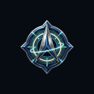

<div align="center">


<br /><br />



# COSMIC SURVIVORS
### **v10.0 — Genesis Edition | WebGL2 Space Survival Roguelike**

[](https://cosmic.haking.tr/)
[](https://cosmic.haking.tr/modes.html)
[](https://cosmic.haking.tr/armory.html)
[](https://cosmic.haking.tr/tree.html)
[](https://buymeacoffee.com/haking)
[](LICENSE)

<p align="center">
  <strong>PixiJS v8 WebGL + pixi-filters • 8 Starships &amp; Unlockable Liveries • 5 Game Modes • 5600×5600 Obstacle Sectors • Tactical Radar • 53 Modules (19 Evolutions + 6 Mega-Evolutions) • EN/TR Bilingual UI</strong>
</p>

[English Documentation](#-overview) • [Türkçe Dokümantasyon](#türkçe-dokümantasyon)

</div>

---

## Overview

**COSMIC SURVIVORS v10.0 — Genesis Edition** is an independent, zero-installation browser sci-fi survival roguelike built by **Halit Güneş (HaKING)**. Powered by hardware-accelerated **PixiJS v8 WebGL** and **pixi-filters** (with automatic Canvas2D fallback), it blends high-contrast bullet-hell boss encounters, dual-weapon synthesis evolutions, expansive obstacle-rich arenas, and a calm **Obsidian-Slate** command portal with instant **EN / TR** language switching.

### Key v10.0 Highlights

- **8 Starships & Unlockable Ship Liveries:** Each chassis brings distinct base stats, passive traits, a `[SPACE]` active ability, signature weapon/trinket synergy, and unlockable custom hull liveries.
- **53 Combat Modules (`X + Y = Z -> MEGA`):** **14 Weapons** (6 universal + 8 signature), **14 Passive Trinkets**, **19 Evolutions**, and **6 Mega-Evolutions** that fuse evolved weapons and free up an extra weapon slot mid-run.
- **5 Distinct Game Modes:** **Campaign**, **Endless**, **Boss Rush**, **5-Min Time Attack**, and **Daily Seeded Protocol** (`modes.html`).
- **4 Expansive `5600×5600` Obstacle-Rich Sectors + Tactical Radar:** Battle across large orbital arenas filled with destructible asteroids, solid bulkhead walls, reactor cores, vault bunkers, `CosmicMapDirector` orbital events, and a live **Tactical Radar Minimap**.
- **Multi-Phase Bullet-Hell Bosses:** Face `Oblivion Behemoth`, `Void Leviathan`, `Hivemind Dreadcore`, `Chronos Weaver`, and `Astral Seraphim`, each entering **Rage Phase II** below 50% HP with escalated patterns and telegraphed attacks.
- **Active Combat Skill Ceilings:** Toggle `[Q]` **Aim Mastery Bonus** (rewarding manual twin-stick precision over auto-lock) and unleash `[E]` **Cosmic Overdrive** when charged.
- **10 Permanent R&D Upgrades:** Reinvest salvage credits in the Hangar R&D Workshop across 10 persistent engineering tracks.
- **100% Browser / Offline Architecture:** Zero external backend, zero tracking, and zero external score servers — all pilot records, achievements, liveries, and R&D upgrades remain privately in local browser storage (`localStorage`) under the **MIT License**.

---

## 5 Game Modes

| Mode | Format | Tactical Focus |
| :--- | :--- | :--- |
| **Campaign** | Structured Escalation | Clear curated sector wave milestones and multi-phase boss checkpoints. |
| **Endless** | Infinite Waves | Push builds beyond **Wave 25+ Cosmic Decay** as enemy density and intensity scale indefinitely. |
| **Boss Rush** | Consecutive Boss Gauntlet | Back-to-back multi-phase bullet-hell boss encounters with accelerated progression. |
| **5-Min Time Attack** | 300-Second Sprint | Maximize eliminations, evolutions, and score efficiency within a strict 5-minute clock. |
| **Daily Seeded Protocol** | Deterministic Daily Seed | Identical wave & event sequence refreshed daily for fair personal benchmarking. |

---

## 8 Starships & Signature Systems

| Starship | Role | Starter Weapon | Signature Evolution (`X + Y = Z`) | Active Ability (`SPACE`) |
| :--- | :--- | :--- | :--- | :--- |
| **Interceptor** | High-Speed Striker | Dual Laser | **Tachyon Lance** *(Photon Railgun + Overdrive Core)* | **Warp Dash** |
| **Dreadnought** | Heavy Siege Armor | Heavy Plasma | **Siege Behemoth** *(Flak Artillery + Reactive Armor)* | **360° Micro-Missile Salvo** |
| **Aegis** | Shield & EMP Guardian | Energy Disc | **Sanctuary Maelstrom** *(Tesla Prism + Harmonic Capacitor)* | **EMP Shockwave** |
| **Void Phantom** | Stealth & Crit Assassin | Quantum Dagger | **Abyssal Reaper** *(Void Scythe + Phase Cloak)* | **Shadow Blink** |
| **Solar Flare** | Thermal AoE Cruiser | Flame Line | **Helios Cataclysm** *(Solar Mortar + Fusion Heart)* | **Solar Nova** |
| **Tempest** | Cryo Crowd-Control | Dual Laser | **Absolute Zero** *(Cryo Nova + Tesla Coil)* | **Cryo-Tesla Storm** |
| **Valkyrie** | Autonomous Drone Carrier | Swarm Missiles | **Seraph Fleet** *(Drone Swarm + Neural Link)* | **Railgun Overdrive** |
| **Chronos** | Temporal Weaver | Energy Disc | **Eternity Loop** *(Chrono Rift + Flux Capacitor)* | **Time Freeze** |

---

## 4 Expansive `5600×5600` Obstacle Sectors

Every sector runs on a `5600×5600` tactical grid with solid/destructible cover (`asteroid_cluster`, `bulkhead_h`, `bulkhead_v`, `reactor_core`, `vault_bunker`), live **Tactical Radar** tracking, and **CosmicMapDirector** dynamic orbital hazards:

1. **Sector 9 Wreckage (`sector9`):** Drifting diagonal wreckage lanes, destructible asteroids, tactical bulkheads, and capturable **Overdrive Pylons**.
2. **Quantum Nebula (`nebula`):** High-velocity plasma slipstreams, roaming EMP storm cells, and charged EMP nodes.
3. **Black Hole Rim (`blackhole`):** Orbiting gravitational singularity core and telegraphed lava meteor bombardments.
4. **Dyson Mega-Sphere Reactor (`dyson`):** Rotating conductor rings, 2.1s telegraphed sweeping Dyson beams, and dense elite formations.

---

## Controls

| Input | Action |
| :--- | :--- |
| `W A S D` / Arrow Keys | Starship thrust & tactical cover positioning |
| **Mouse Cursor** / `[Q]` | Toggle **Manual Twin-Stick Aim (Aim Mastery Bonus)** ⇄ **Auto-Lock** (virtual joystick on touch devices) |
| `SPACE` | Trigger Starship Active Ability |
| `E` | Activate **Cosmic Overdrive** burst |
| `1` / `2` / `3` | Atomic zero-race card selection on Level Up |
| `ESC` | Tactical Pause, Audio Mixer & Calm VFX Mode |

---

## Offline Tech Stack & Project Structure

All frontend dependencies are vendored in `vendor/` for reliable offline execution without external CDN dependencies:

- **Rendering & FX:** `PixiJS v8` (`vendor/pixi.min.js`), `pixi-filters` (`vendor/pixi-filters.min.js`), automatic `Canvas2D` fallback
- **Audio & UI:** `Howler.js` (`vendor/howler.min.js`) + Web Audio spatial ambient synth, `GSAP` (`vendor/gsap.min.js`), `Lucide` (`vendor/lucide.min.js`), `canvas-confetti` (`vendor/confetti.min.js`)
- **Analytics & Search:** `Chart.js` (`vendor/chart.umd.min.js`), `Fuse.js` (`vendor/fuse.min.js`), `@panzoom/panzoom` (`vendor/panzoom.min.js`)
- **Assets:** Compiled **Kenney (CC0 1.0)** ship/enemy/obstacle/FX sprites & OGG sound effects + custom painted sector backdrops

```text
COSMIC/
├── index.html               # Command Hangar (8 Ships, Liveries, 10 R&D Upgrades, Local Pilot Records)
├── game.html / game.js      # Combat Arena (5 Modes, 5600x5600 Obstacle Sectors, Tactical Radar, Multi-Phase Bosses)
├── modes.html               # 5 Game Modes Hub & Tactical Modifiers
├── armory.html              # Hangar Armory (Ship Liveries, 10 R&D Upgrades & Loadout Preview)
├── tree.html                # Evolution Blueprint Lab (Panzoom & Interactive SVG Synthesis Graph)
├── wiki.html                # Tactical Encyclopedia (Fuse.js Search, Chart.js DPS Telemetry, Synthesis Simulator)
├── about.html               # Architecture, Controls, Official Channels & MIT License
├── css/                     # Obsidian-Slate Design System (core.css, lobby.css, game.css, tree.css, wiki.css)
├── js/                      # Canonical Engine Modules (i18n.js, data.js, renderer.js, mapEvents.js, audio.js, ...)
├── vendor/                  # Vendored Offline Libraries (PixiJS v8, pixi-filters, Fuse.js, Howler, Chart.js, GSAP, Panzoom, Confetti, Lucide)
└── assets/                  # PNG Sprites, Obstacles, Backdrops, Keyart, OG Banner, PWA Icons & OGG Audio
```

### Local Launch

Serve the static directory with any local HTTP server:

```bash
git clone https://github.com/HaKING06/COSMIC.git
cd COSMIC
npx http-server -p 8080
```

Open `http://127.0.0.1:8080` in your browser to enter the Command Hangar.

---

## Official Channels & License

- **Play Online:** [cosmic.haking.tr](https://cosmic.haking.tr/)
- **Author:** Halit Güneş (`HaKING`)
- **Official Email:** [cosmic@haking.tr](mailto:cosmic@haking.tr)
- **GitHub Repository:** [github.com/HaKING06/COSMIC](https://github.com/HaKING06/COSMIC)
- **Support Development:** [buymeacoffee.com/haking](https://buymeacoffee.com/haking)
- **Asset Attribution:** Sprites and SFX compiled from **Kenney (CC0 1.0)**.
- **License:** [MIT License](LICENSE) — `Copyright (c) 2026 Halit Güneş (HaKING)`

---

<a id="türkçe-dokümantasyon"></a>

## Türkçe Dokümantasyon

**COSMIC SURVIVORS v10.0 — Genesis Edition**, **Halit Güneş (HaKING)** tarafından geliştirilen; kurulum gerektirmeyen, WebGL2 hızlandırmalı (**PixiJS v8** + **pixi-filters** ve otomatik Canvas2D yedekli), harici sunucusuz tam çevrimdışı çalışan bilim kurgu hayatta kalma ve evrim sentez oyunudur. Arayüz üst çubuğundaki **EN / TR** seçicisi ile tüm portalı anında İngilizce veya Türkçe kullanabilirsiniz.

### v10.0 Genesis Edition Yenilikleri

- **8 Yıldız Gemisi & Açılabilir Gemi Kaplamaları (Liveries):** Her gemi özgün istatistiklere, pasif yeteneklere, `[SPACE]` aktif becerisine, imza silah/alet sinerjisine ve açılabilir özel gövde kaplamalarına sahiptir.
- **53 Savaş Modülü (`X + Y = Z -> MEGA`):** 14 Silah (6 evrensel + 8 imza), 14 Destek Modülü (Trinket), 19 Evrim ve iki evrimi birleştirip fazladan silah yuvası açan **6 Mega-Evrim**.
- **5 Özgün Oyun Modu:** **Campaign (Sefer)**, **Endless (Sonsuz)**, **Boss Rush**, **5-Min Time Attack (5 Dakika Zaman Saldırısı)** ve **Daily Seeded Protocol (Günlük Sabit Tohum Protokolü)**.
- **4 Geniş `5600×5600` Engelli Sektör & Taktik Radar:** Asteroid kümeleri, perde duvarlar, reaktör çekirdekleri ve sığınak siperleriyle donatılmış dev arenalarda (`Sektör 9`, `Kuantum Nebulası`, `Kara Delik Çevresi`, `Dyson Mega-Küre`) canlı **Taktik Radar Mini Haritası** ve `CosmicMapDirector` olaylarıyla savaşın.
- **Çok Fazlı Mermi Cehennemi Bosslar:** `Oblivion Behemoth`, `Void Leviathan`, `Hivemind Dreadcore`, `Chronos Weaver` ve `Astral Seraphim` %50 HP altında **Öfke Fazı II**'ye geçer.
- **Ustalık Mekanikleri:** `[Q]` **Nişan Ustalığı Bonusu** (manuel twin-stick nişana ekstra ödül) ve `[E]` **Kozmik Overdrive** patlaması.
- **10 Kalıcı Ar-Ge Yükseltmesi:** Hangar Araştırma Atölyesinde kazandığınız kredilerle 10 kalıcı güçlendirme hattını geliştirin.
- **Tam Çevrimdışı / Arka Uçsuz Mimari:** Harici sunucu veya izleme olmadan tüm pilot kayıtları, başarımlar, kaplamalar ve Ar-Ge ilerlemeleri tarayıcınızda (`localStorage`) güvenle saklanır.

### Kontroller (Türkçe)

| Giriş | Aksiyon |
| :--- | :--- |
| `W A S D` / Yön Tuşları | `5600×5600` engelli sektörde gemi manevrası ve siper konumlanması |
| **Fare İmleci** / `[Q]` | **Manuel Twin-Stick Nişan (Nişan Ustalığı Bonusu)** ⇄ **Otomatik Hedef Kilidi** geçişi |
| `SPACE` | Gemiye Özel Aktif Yetenek (`Warp Dash`, `EMP`, `Zaman Durdurma` vb.) |
| `E` | **Kozmik Overdrive** patlamasını tetikleme |
| `1` / `2` / `3` | Seviye atlamada atomik kilitle hızlı kart / evrim seçimi |
| `ESC` | Taktik Duraklatma, Ses Mikseri ve Göz Dostu Sakin VFX Modu |

### Resmi Bağlantılar & Lisans

- **Canlı Portal:** [cosmic.haking.tr](https://cosmic.haking.tr/)
- **Geliştirici:** Halit Güneş (`HaKING`)
- **Resmi E-Posta:** [cosmic@haking.tr](mailto:cosmic@haking.tr)
- **GitHub Deposu:** [github.com/HaKING06/COSMIC](https://github.com/HaKING06/COSMIC)
- **Projeyi Destekle:** [buymeacoffee.com/haking](https://buymeacoffee.com/haking)
- **Varlık Kredisi:** Sprite ve ses efektleri **Kenney (CC0 1.0)** varlık paketlerinden derlenmiştir.
- **Lisans:** [MIT License](LICENSE) — `Copyright (c) 2026 Halit Güneş (HaKING)`
