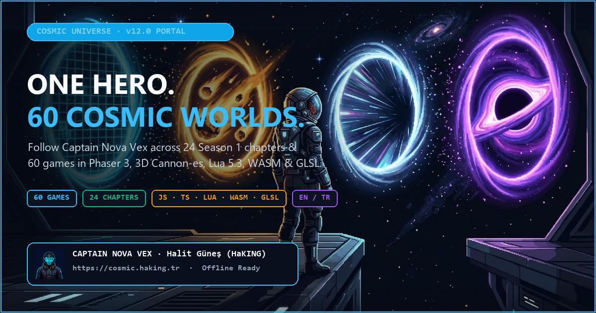

<div align="center">

# COSMIC UNIVERSE — v12.0 Çoklu Evren Oyun Portalı

**60 Oynanabilir Uzay Tarayıcı Oyunu · Kaptan Nova Vex 24 Bölümlük Sezon 1 Destanı · Çoklu Dil ve Çoklu Motor Portföyü**

[](README.md)
[](https://cosmic.haking.tr/)
[](https://cosmic.haking.tr/#gamesGrid)
[](#çoklu-dil-ve-çoklu-motor-mimarisi)
[](LICENSE)



</div>

---

## Genel Bakış

**COSMIC UNIVERSE v12.0**, **Halit Güneş (HaKING)** tarafından geliştirilen; arka uç sunucusu gerektirmeyen, tamamen tarayıcıda çalışan bağımsız bir bilim kurgu oyun portalıdır. **Kaptan Nova Vex**, **S.A.R.A. AI** ve **Amiral Kaelen** etrafında şekillenen evren; her biri kendi SEO sayfasına (`games/<slug>/index.html`) ve **Sonsuz / Serbest Mod** ile **Hikâye Görevi** seçeneklerini ayıran başlangıç menüsüne sahip **60 özgün tarayıcı oyununu**, canlı **60 FPS animasyonlu ara sahneler** içeren **24 bölümlük Sezon 1 Hikâye Destanını**, **256×256 özel oyun logolarını** ve **60 metinsiz 16:9 afişi** tek çatıda buluşturur.

### Öne Çıkan Yenilikler (v12.0)

- **60 Özgün Uzay Oyunu & Çift Mod Mimarisi:** Her oyun sayfası kendi **Başlangıç Menüsü** ile (**Sonsuz / Serbest Mod** · **Hikâye Görevi** · zorluk seçimi · yerel rekor kaydı) açılır; portal üzerinden başlatılan tüm oyunlar sonsuz ve serbest kurallarla çalışır.
- **Amiral Gemisi Çoklu Motor & Çoklu Dil Altyapısı (#51–#60 & v12 Güncellemesi):** Phaser 3 Arcade Fizik motoru, Three.js + Cannon-es gerçek 3D fizik, ROT.js prosedürel zindan üretimi, canlı düzenlenebilir **Fengari Lua 5.3 Sanal Makinesi**, derlenmiş **AssemblyScript `.wasm`** kara delik sürüsü, **D3.js** galaktik strateji haritası ve saf **WebGL2 GLSL SDF raymarching** gölgelendiricileri içerir.
- **Kaptan Nova Vex — 24 Bölümlük Sezon 1 Destanı (`story.html`):** Takımyıldız rota düğümlerine sahip 4 Perde (Perde I–IV), çok katmanlı 60 FPS sinematik ara sahne oynatıcısı (uzay savaşı efektleri, S.A.R.A. holografik telemetrisi, darbe şok dalgaları), 3 adımlı sahne zaman çizelgesi, otomatik kayıt devamı ve çarpıcı Sezon 1 finali sunar.
- **Kusursuzlaştırılmış Fizik & Arayüz Düzeltmeleri:** Platform ve aksiyon oyunlarında düşmanların asit/tehlike çukurlarına düşüp takılmasını önleyen kenar algılama ve asit eritme sistemi, çıkmaza girmeyen bulmaca çözücüleri, tüm ölçeklerde doğru çalışan fare/nişan koordinatları, portal alt sayfalarında bütüncül koyu tema bileşenleri ve 71 URL'li `sitemap.xml` + JSON-LD SEO şemaları içerir.

---

## Çoklu Dil ve Çoklu Motor Mimarisi

| Çalışma Katmanı | Teknoloji Yığını | Güç Verdiği Modüller |
| :--- | :--- | :--- |
| **Phaser 3.88 Motoru** | Phaser 3 Arcade Fiziği & Boss Yapay Zekâsı (`vendor/phaser.min.js`) | `exo-metroid-breach`, `phaser-stealth-heist`, `phaser-crimson-colossus` |
| **3D Fizik & WebGL** | Three.js + Cannon-es 3D Rijit Cisim Fiziği (`vendor/three.min.js`, `cannon-es.min.js`) | `moon-rover-3d-odyssey`, `starfox-canyon-ace`, `three-void-interceptor`, `three-star-slalom`, `helix-station-drop` |
| **Lua 5.3 Sanal Makinesi** | Canlı Fengari Lua 5.3 VM (`vendor/fengari-web.js`, `lua/mission_kernel.lua`) | `lua-cyber-ops` (oyun içi düzenlenebilir canlı Lua yapay zekâ çipleri) |
| **AssemblyScript + WAT WASM** | AssemblyScript (`assembly/cosmic_adv.ts` -> `wasm/cosmic_adv.wasm`) & WAT (`wasm/cosmic_sim.wat`) | `asc-blackhole-swarm`, `wasm-bullet-weave`, `wasm-cellular-contain` |
| **Saf GLSL Gölgelendiriciler** | WebGL2 SDF Raymarching + Parça Gölgelendiricileri (`shaders/cosmicShaders.js`) | `glsl-synthwave-surf`, `shader-pulse-survivor` |
| **ROT.js & D3.js Strateji** | ROT.js Roguelike + D3.js Kuvvet Ağı RTS (`vendor/rot.min.js`, `vendor/d3.min.js`) | `astral-roguelike-crawl`, `d3-galactic-conquest`, `phaser-stealth-heist` görüş konisi |
| **TypeScript Çekirdeği** | Katı TypeScript + BFS/GF(2)/Tekil Çözücüler (`ts/puzzleEngine.ts`) | 12 mantık ve şifre bulmacası (`js/ts_compiled/puzzleEngine.js`) |
| **2D Rijit Fizik Motoru** | Matter.js (`vendor/matter.min.js`) | 7 kütleçekim, halat, ay inişi, langırt, bilardo ve denge oyunu |
| **2D WebGL2 Amiral Gemisi** | PixiJS v8 + pixi-filters (`hangar.html`, `game.html`) | *Cosmic Survivors* (8 uzay gemisi, dört 5600×5600 engelli arena, 5 mod, 53 modül) |
| **Arayüz, Arama & Ara Sahne** | `js/cutscenePlayer.js`, Fuse.js, Howler.js, Chart.js, GSAP, Panzoom | 60 FPS Sezon 1 ara sahneleri, anlık arama, telemetri ve Türkçe/İngilizce dil desteği |

---

## Kaptan Nova Vex — 24 Bölümlük Sezon 1 Destanı (`story.html`)

| Perde / Bölüm | Bölüm Adı | Biyom Sektörü | Görev Bağlantısı |
| :--- | :--- | :--- | :--- |
| **Perde I · Böl.1** | **Yörünge İhlali** | `Sektör 01 — Vesta İleri Karakolu` | [nova-flappy-rift](games/nova-flappy-rift/index.html?chapter=1) |
| **Perde I · Böl.2** | **Tersane Kilidi** | `Sektör 02 — Hyperion Kargo Tersanesi` | [quantum-sokoban](games/quantum-sokoban/index.html?chapter=2) |
| **Perde I · Böl.3** | **Kızıl Sürü** | `Sektör 03 — Kızıl Bulutsu Ablukası` | [boss-gauntlet](games/boss-gauntlet/index.html?chapter=3) |
| **Perde I · Böl.4** | **Kütleçekim Tekilliği** | `Sektör 04 — Kara Yıldız Eşiği` | [orbital-slingshot](games/orbital-slingshot/index.html?chapter=4) |
| **Perde I · Böl.5** | **Dyson Devre Matrisi** | `Sektör 05 — Kadim Dyson Halkası` | [circuit-pipe-link](games/circuit-pipe-link/index.html?chapter=5) |
| **Perde I · Böl.6** | **3D Hiper-Büküm Koridoru** | `Sektör 06 — Kuantum Büküm Tüneli` | [three-void-interceptor](games/three-void-interceptor/index.html?chapter=6) |
| **Perde II · Böl.7** | **Kronos Mermi Paradoksu** | `Sektör 07 — Kronos Saat Kulesi Çekirdeği` | [wasm-bullet-weave](games/wasm-bullet-weave/index.html?chapter=7) |
| **Perde II · Böl.8** | **Sonsuzluk Tahtı** | `Sektör 08 — Parçalanan Sonsuzluk Merkezi` | [tower-defense-bastion](games/tower-defense-bastion/index.html?chapter=8) |
| **Perde II · Böl.9** | **Vesta-9 Suikast Dosyası** | `Sektör 09 — Buzul Kristal Reviri` | [starship-murder-mystery](games/starship-murder-mystery/index.html?chapter=9) |
| **Perde II · Böl.10** | **Kırık Armada Yolu** | `Sektör 10 — Kızıl Enkaz Kuşağı` | [three-star-slalom](games/three-star-slalom/index.html?chapter=10) |
| **Perde II · Böl.11** | **Kara Röle Şifresi** | `Sektör 11 — Şimşek İletişim Kulesi` | [typing-cipher-defense](games/typing-cipher-defense/index.html?chapter=11) |
| **Perde II · Böl.12** | **Klon Güvertesi** | `Sektör 12 — Yarı-İnsan Laboratuvarı` | [astral-roguelike-crawl](games/astral-roguelike-crawl/index.html?chapter=12) |
| **Perde III · Böl.13** | **Kızıl Dökümhane** | `Sektör 13 — Hephaestus Volkanik Uydusu` | [moon-rover-3d-odyssey](games/moon-rover-3d-odyssey/index.html?chapter=13) |
| **Perde III · Böl.14** | **Monolit Hiper-Tüneli** | `Sektör 14 — Mor Boyut Geçidi` | [glsl-synthwave-surf](games/glsl-synthwave-surf/index.html?chapter=14) |
| **Perde III · Böl.15** | **Dyson Güneş Çekirdeği** | `Sektör 15 — Altın Güneş Kuşağı` | [exo-metroid-breach](games/exo-metroid-breach/index.html?chapter=15) |
| **Perde III · Böl.16** | **Kara Delik Karantinası** | `Sektör 16 — Zincirli Tekillik Kuyusu` | [wasm-cellular-contain](games/wasm-cellular-contain/index.html?chapter=16) |
| **Perde III · Böl.17** | **Komuta Gemisine Sızma** | `Sektör 17 — Kaelen Sancak Koridoru` | [phaser-stealth-heist](games/phaser-stealth-heist/index.html?chapter=17) |
| **Perde III · Böl.18** | **Alev Kuşatması** | `Sektör 18 — Çatlak Köprü Yörüngesi` | [starfox-canyon-ace](games/starfox-canyon-ace/index.html?chapter=18) |
| **Perde IV · Böl.19** | **Galaktik Karşı Taarruz** | `Sektör 19 — Altın Konsey Haritası` | [d3-galactic-conquest](games/d3-galactic-conquest/index.html?chapter=19) |
| **Perde IV · Böl.20** | **Zümrüt Çekirdek Taarruzu** | `Sektör 20 — Fırtına Hiper-Sıçrayışı` | [lua-cyber-ops](games/lua-cyber-ops/index.html?chapter=20) |
| **Perde IV · Böl.21** | **S.A.R.A.’nın Yanması** | `Sektör 21 — Kuantum Sunucu Kalbi` | [photon-parry-duel](games/photon-parry-duel/index.html?chapter=21) |
| **Perde IV · Böl.22** | **Küllenen Ufuk** | `Sektör 22 — Dretnot Saldırı Hattı` | [shader-pulse-survivor](games/shader-pulse-survivor/index.html?chapter=22) |
| **Perde IV · Böl.23** | **Kızıl Kolossus Hesaplaşması** | `Sektör 23 — Kaelen’in Zirve Platformu` | [phaser-crimson-colossus](games/phaser-crimson-colossus/index.html?chapter=23) |
| **Perde IV · Böl.24** | **Sezon Finali — S.A.R.A.’nın Fedakârlığı** | `Sektör 24 — PARÇALANAN SONSUZLUK` | [asc-blackhole-swarm](games/asc-blackhole-swarm/index.html?chapter=24) |

---

## 60 Oynanabilir Uzay Oyunu Kataloğu

| # | Oyun Adı | Tür | Motor | Dil |
| :---: | :--- | :---: | :--- | :---: |
| #01 | [Kozmik Hayatta Kalanlar (Ana Sefer)](hangar.html) | `Ana & 3D` | PixiJS v8 | `JS` |
| #02 | [Kızıl Sürü: Boss Arenası](games/boss-gauntlet/index.html) | `Ana & 3D` | PixiJS v8 | `JS` |
| #03 | [3D Hipertünel Avcısı](games/three-void-interceptor/index.html) | `Ana & 3D` | Three.js 3D | `JS` |
| #04 | [3D Yıldız Slalomu](games/three-star-slalom/index.html) | `Ana & 3D` | Three.js 3D | `JS` |
| #05 | [WASM Mermi Dokumacı](games/wasm-bullet-weave/index.html) | `Ana & 3D` | WebAssembly | `WASM` |
| #06 | [GLSL Ufuk Nabzı](games/shader-pulse-survivor/index.html) | `Ana & 3D` | GLSL WebGL2 | `GLSL` |
| #07 | [Nova Yarık Sıçrayışı](games/nova-flappy-rift/index.html) | `Refleks & Kaçış` | Neo-Pixel | `JS` |
| #08 | [Yerçekimi Ters Çeviren Koşucu](games/gravity-flip-runner/index.html) | `Refleks & Kaçış` | Neo-Pixel | `JS` |
| #09 | [Yörünge Atılma Halkası](games/orbital-dash-ring/index.html) | `Refleks & Kaçış` | Neo-Pixel | `JS` |
| #10 | [Büküm Şeridi Kaçışı](games/warp-lane-dodger/index.html) | `Refleks & Kaçış` | Neo-Pixel | `JS` |
| #11 | [Foton Savuşturma Düellosu](games/photon-parry-duel/index.html) | `Refleks & Kaçış` | Neo-Pixel | `JS` |
| #12 | [Meteor Sırt Roketi Yükselişi](games/meteor-jetpack-rise/index.html) | `Refleks & Kaçış` | Neo-Pixel | `JS` |
| #13 | [3D Sarmal İstasyon Düşüşü](games/helix-station-drop/index.html) | `Refleks & Kaçış` | Three.js 3D | `JS` |
| #14 | [Lazer Altından Atılma](games/laser-limbo-dash/index.html) | `Refleks & Kaçış` | Neo-Pixel | `JS` |
| #15 | [Yıldız Işığı Ritim Nabzı](games/starlight-rhythm-pulse/index.html) | `Refleks & Kaçış` | Neo-Pixel | `JS` |
| #16 | [Vesta-9: Uzay Gemisi Cinayet Dosyası](games/starship-murder-mystery/index.html) | `Taktik & Gizem` | Neo-Pixel | `JS` |
| #17 | [Galaktik Sürü Taarruzu](games/galaga-swarm-assault/index.html) | `Klasik Arcade` | Neo-Pixel | `JS` |
| #18 | [Yatay Sektör Muhafızı](games/defender-patrol/index.html) | `Klasik Arcade` | Neo-Pixel | `JS` |
| #19 | [Astro Vektör Asteroitler](games/astro-vector-asteroids/index.html) | `Klasik Arcade` | Neo-Pixel | `JS` |
| #20 | [Kozmik Yılan Leviathan](games/cosmic-snake-leviathan/index.html) | `Klasik Arcade` | Neo-Pixel | `JS` |
| #21 | [Kuantum Blok Kırıcı](games/quantum-brick-breaker/index.html) | `Klasik Arcade` | Neo-Pixel | `JS` |
| #22 | [İkiz Palet Kuantum Pong](games/twin-paddle-pong/index.html) | `Klasik Arcade` | Neo-Pixel | `JS` |
| #23 | [Spor Kırkayağı İmhası](games/centipede-spore-purge/index.html) | `Klasik Arcade` | Neo-Pixel | `JS` |
| #24 | [Füze Kubbe Savunması](games/missile-dome-defense/index.html) | `Klasik Arcade` | Neo-Pixel | `JS` |
| #25 | [Ay Yüzeyi Kazıcısı](games/lunar-excavator/index.html) | `Klasik Arcade` | Neo-Pixel | `JS` |
| #26 | [Kuantum Kargo Sokoban](games/quantum-sokoban/index.html) | `Bulmaca & Şifre` | TypeScript | `TS` |
| #27 | [Lazer Ayna Matrisi](games/laser-mirror-grid/index.html) | `Bulmaca & Şifre` | TypeScript | `TS` |
| #28 | [Dyson Devre Bağlantısı](games/circuit-pipe-link/index.html) | `Bulmaca & Şifre` | TypeScript | `TS` |
| #29 | [Kuantum 2048 Füzyonu](games/quantum-2048/index.html) | `Bulmaca & Şifre` | TypeScript | `TS` |
| #30 | [Nebula Mayın Tarlası](games/nebula-minesweeper/index.html) | `Bulmaca & Şifre` | TypeScript | `TS` |
| #31 | [İzotop Eşleştirme Çekirdeği](games/match3-isotope-core/index.html) | `Bulmaca & Şifre` | TypeScript | `TS` |
| #32 | [Işıkları Söndür Dizisi](games/lights-out-array/index.html) | `Bulmaca & Şifre` | TypeScript | `TS` |
| #33 | [Yıldız Hafıza Matrisi](games/memory-star-matrix/index.html) | `Bulmaca & Şifre` | TypeScript | `TS` |
| #34 | [Nonogram Yıldız Haritası](games/nonogram-star-map/index.html) | `Bulmaca & Şifre` | TypeScript | `TS` |
| #35 | [Hanoi Büküm Çekirdekleri](games/hanoi-warp-cores/index.html) | `Bulmaca & Şifre` | TypeScript | `TS` |
| #36 | [WASM Hücresel Karantina](games/wasm-cellular-contain/index.html) | `Bulmaca & Şifre` | WebAssembly | `WASM` |
| #37 | [Yörünge Mini Sudoku](games/orbital-sudoku-mini/index.html) | `Bulmaca & Şifre` | TypeScript | `TS` |
| #38 | [Yörünge Sapanı (Tekillik)](games/orbital-slingshot/index.html) | `Fizik & Çekim` | Matter.js | `JS` |
| #39 | [Ay İniş Modülü Apollo](games/moon-lander-apollo/index.html) | `Fizik & Çekim` | Matter.js | `JS` |
| #40 | [Kozmik Langırt / Tilt Masası](games/cosmic-pinball-rig/index.html) | `Fizik & Çekim` | Matter.js | `JS` |
| #41 | [Nebula Bilardo Sekmesi](games/nebula-pool-ricochet/index.html) | `Fizik & Çekim` | Matter.js | `JS` |
| #42 | [Kargo Kulesi Dengesi](games/cargo-tower-balance/index.html) | `Fizik & Çekim` | Matter.js | `JS` |
| #43 | [Manyetik Halat Salınımı](games/magnetic-tether-swing/index.html) | `Fizik & Çekim` | Matter.js | `JS` |
| #44 | [Parsec Yerçekimi Golfü](games/gravity-golf-parsec/index.html) | `Fizik & Çekim` | Matter.js | `JS` |
| #45 | [Sonsuzluk Kalesi Kule Savunması](games/tower-defense-bastion/index.html) | `Taktik & Gizem` | PixiJS v8 | `JS` |
| #46 | [Güverte İhlal Taktikleri](games/deck-breach-tactics/index.html) | `Taktik & Gizem` | TypeScript | `TS` |
| #47 | [Filo Komutanı Oto-Savaş](games/fleet-commander-auto/index.html) | `Taktik & Gizem` | Neo-Pixel | `JS` |
| #48 | [Solucan Deliği Rulet RYO](games/wormhole-roulette-rpg/index.html) | `Taktik & Gizem` | Neo-Pixel | `JS` |
| #49 | [Asteroit Maden İmparatorluğu](games/mining-tycoon-idle/index.html) | `Taktik & Gizem` | Neo-Pixel | `JS` |
| #50 | [Şifre Yazım Savunması](games/typing-cipher-defense/index.html) | `Taktik & Gizem` | TypeScript | `TS` |
| #51 | [Exo-Metroid Sektör İhlali](games/exo-metroid-breach/index.html) | `Ana & 3D` | Phaser 3 | `JS` |
| #52 | [Astral Zindan Kâşifi](games/astral-roguelike-crawl/index.html) | `Taktik & Gizem` | ROT.js | `JS` |
| #53 | [Ay Gezgini 3D Fizik Rallisi](games/moon-rover-3d-odyssey/index.html) | `Fizik & Çekim` | Cannon-es 3D | `JS` |
| #54 | [Yıldız Tilkisi 3D Kanyon Ası](games/starfox-canyon-ace/index.html) | `Klasik Arcade` | Cannon-es 3D | `JS` |
| #55 | [Lua 5.3 Siber Drone Arenası](games/lua-cyber-ops/index.html) | `Taktik & Gizem` | Lua 5.3 VM | `LUA` |
| #56 | [Olay Ufku: AssemblyScript Sürüsü](games/asc-blackhole-swarm/index.html) | `Ana & 3D` | AssemblyScript | `WASM` |
| #57 | [Korsan Sızması: Phaser Gizlilik Operasyonu](games/phaser-stealth-heist/index.html) | `Taktik & Gizem` | Phaser 3 | `JS` |
| #58 | [D3 Galaktik Fethiyye RTS](games/d3-galactic-conquest/index.html) | `Taktik & Gizem` | D3.js Engine | `JS` |
| #59 | [GLSL Raymarch Hiper Sörf](games/glsl-synthwave-surf/index.html) | `Refleks & Kaçış` | GLSL Raymarch | `GLSL` |
| #60 | [Kızıl Kolossus: Boss Baskını](games/phaser-crimson-colossus/index.html) | `Klasik Arcade` | Phaser 3 | `JS` |

---

## Proje Yapısı

```text
COSMIC/
├── index.html                  # v12.0 Çoklu Oyun Portalı & Arama Merkezi (TR/EN)
├── README.md / README.tr.md    # Tam İngilizce ve Tam Türkçe Proje Belgeleri
├── story.html                  # Kaptan Nova Vex 24 Bölümlük Sezon 1 Hikâyesi & Sinema Ara Sahneleri
├── arcade.html                 # Evrensel Oyun Oynatıcısı & Başlangıç Menüsü
├── hangar.html                 # Cosmic Survivors Amiral Gemisi Hangarı (8 Gemi, 5 Mod)
├── game.html / game.js         # PixiJS v8 Hayatta Kalma Arena Motoru
├── armory.html / modes.html    # Ar-Ge Atölyesi, Kaplamalar & Günlük Tohum Modu
├── tree.html / wiki.html       # Panzoom Evrim Ağacı & 53 Modüllü Taktik Ansiklopedi
├── about.html                  # Teknik Mimari, Kontroller, SSS & MIT Lisansı
├── games/<slug>/index.html     # 60 Özel SEO Oyun Sayfası + VideoGame & BreadcrumbList Şeması
├── assembly/ & wasm/           # AssemblyScript (cosmic_adv.ts -> .wasm) & WAT (cosmic_sim.wasm)
├── lua/mission_kernel.lua      # Fengari VM için gömülü Lua 5.3 drone taktik betiği
├── ts/ & js/ts_compiled/       # Katı TypeScript bulmaca motoru ve derlenmiş çıktısı
├── shaders/cosmicShaders.js    # Özel WebGL2 GLSL vertex & fragment gölgelendiricileri
├── js/cutscenePlayer.js        # Sezon 1 için 60 FPS Çok Katmanlı Canlı Ara Sahne Motoru
├── js/games/                   # pack_phaser, pack_advanced3d, pack_multilang, pack_three, pack_reflex, pack_matter, pack_arcade, pack_puzzles, pack_tactics, pack_mystery
├── assets/v11/                 # 24 bölüm sahnesi, 4 karakter portresi, 25 sprite, 60 logo, 60 afiş
├── vendor/                     # Çevrimdışı paketlenmiş Phaser 3, Three.js, Cannon-es, ROT.js, Fengari Lua, D3.js, PixiJS v8, Matter.js, Fuse.js, Howler.js, Chart.js
└── sitemap.xml / manifest.webmanifest / robots.txt
```

---

## Yerelde Çalıştırma

WebAssembly (`.wasm`) dosyaları ve temiz oyun rotaları `file://` yerine HTTP başlıkları gerektirdiğinden proje kök dizinini yerel bir HTTP sunucusuyla başlatın:

```bash
# Seçenek A: Node.js
npx serve .

# Seçenek B: Python 3
python -m http.server 8080
```

İsteğe bağlı geliştirici kontrolleri (`npm install` bağımlılıklarıyla):

```bash
npx tsc --noEmit
```

---

## Resmi Kanallar ve Lisans

- **Geliştirici:** Halit Güneş (HaKING)
- **E-posta:** [cosmic@haking.tr](mailto:cosmic@haking.tr)
- **GitHub:** [github.com/HaKING06/COSMIC](https://github.com/HaKING06/COSMIC)
- **Destek:** [buymeacoffee.com/haking](https://buymeacoffee.com/haking)
- **Lisans:** [MIT Lisansı](LICENSE) kapsamında yayımlanmıştır. Paketlenmiş üçüncü parti çalışma zamanı kütüphaneleri (`vendor/`) ve Kenney CC0 1.0 görsel/ses varlıkları kendi açık kaynak lisanslarına tabidir.
